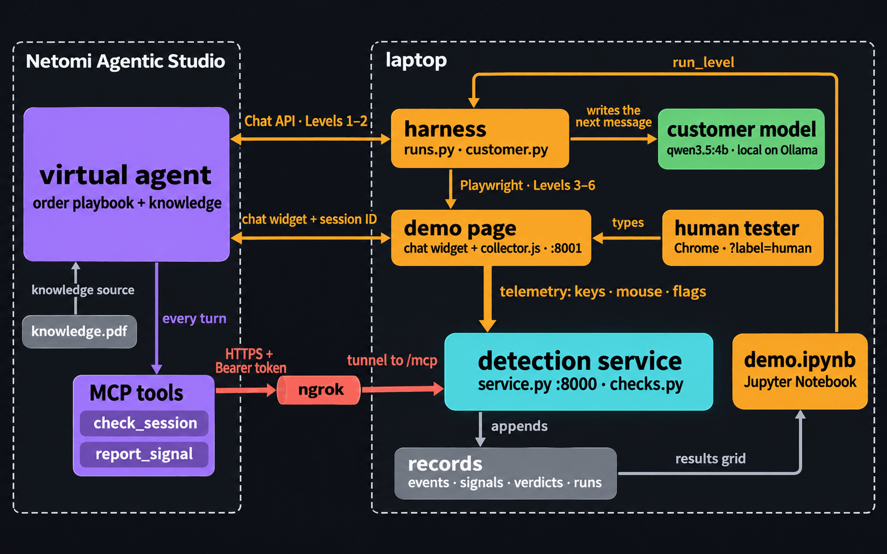

# The Agent Ladder: Detecting AI Agents That Pose as Your Customers
## Contents
1.  [Summary](#summary)
2.  [Presentation](#presentation)
3.  [Architecture](#architecture)
4.  [Features](#features)
5.  [Prerequisites](#prerequisites)
6.  [Installation](#installation)
7.  [Usage](#usage)

## Summary 
A notebook that tests how well a Netomi Virtual Agent (VA), with an external detection service, can spot an AI agent posing as a customer. Six agents, each hiding one more tell, run against it, and ten human sessions check for false alarms.

## Presentation 
[Slide deck](https://joeywhelan.github.io/agent-ladder/)

## Architecture 

## Features 
- Jupyter notebook
- Demo web page with the Netomi chat widget and a collector that records browser flags, keystroke timing and mouse movement (never the keys themselves)
- Detection service (FastAPI) that scores the telemetry and exposes `check_session` and `report_signal` to the VA as MCP tools, published through an ngrok tunnel
- Netomi order playbook that answers an order question from a knowledge source and runs the VA-side checks: asking directly, a writing-style check, and a delivery-day question that invites invented detail
- Simulated customer: `qwen3.5:4b` on Ollama, delivered through the Netomi Chat API (Levels 1–2) or by driving the real widget with Playwright (Levels 3–6, stealth from Level 4)
- Human baseline: input thresholds set from the recorded human sessions and frozen before any agent runs
- Results grid per level plus a human row, with pass/fail against the fixed rule and the signals that caught each level

## Prerequisites 
- Python 3.14 and uv
- Ollama, with `qwen3.5:4b` pulled
- Playwright Chromium
- ngrok account with a static domain
- Netomi account: an AI agent with a web widget channel and Chat API access

## Installation 
- Copy `.env.sample` to `.env` and fill in the values
- `uv sync`
- `uv run playwright install chromium`
- `ollama pull qwen3.5:4b`

## Usage 
- Execute notebook Section 1, then configure Netomi from `assets/netomi/` and record the human sessions as described in Section 2 (the scripts are in `assets/human-sessions.md`)
- Execute the remaining sections in order
